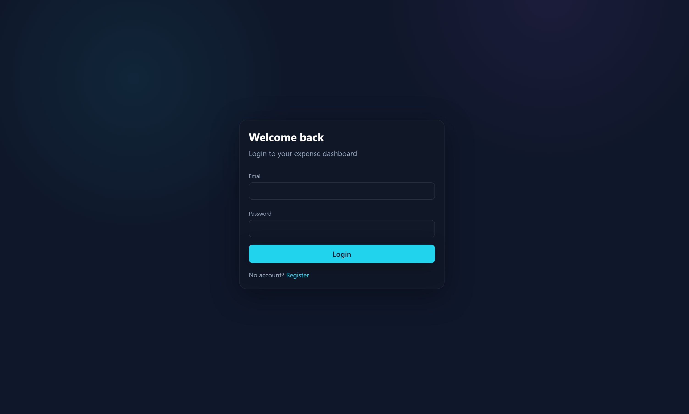
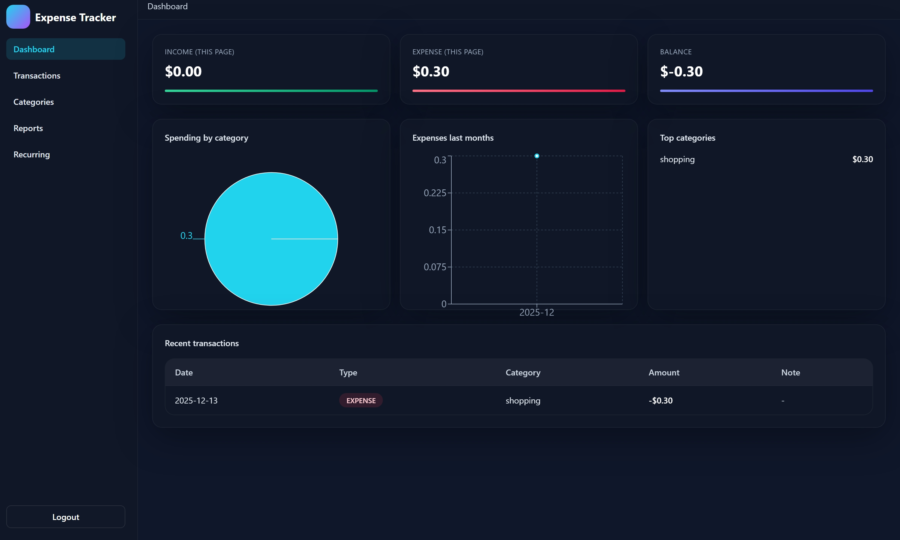
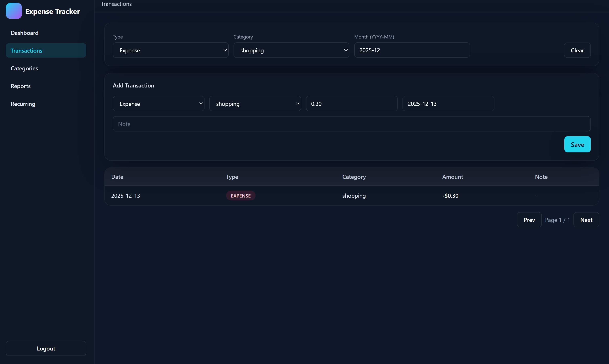
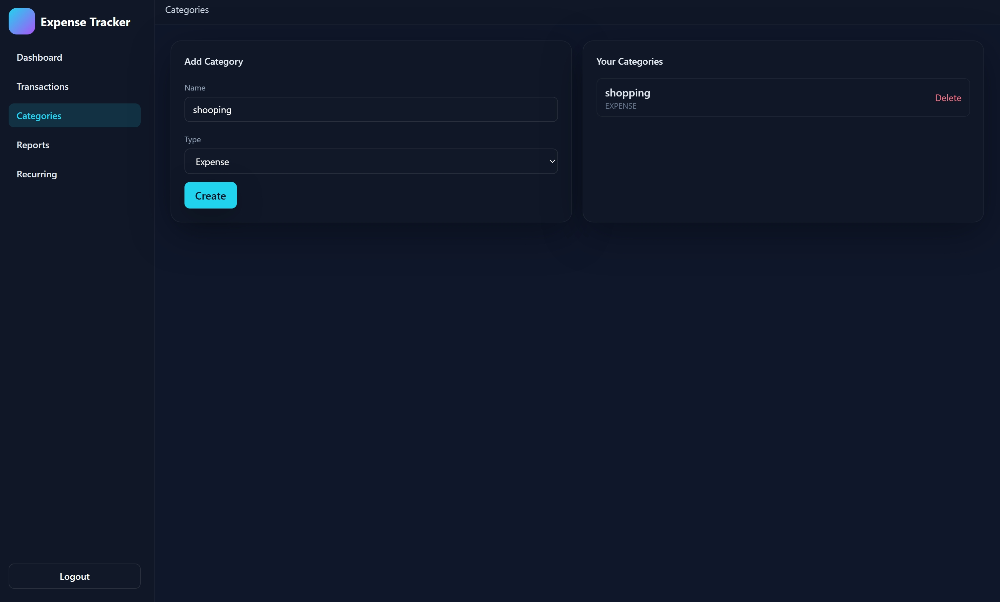
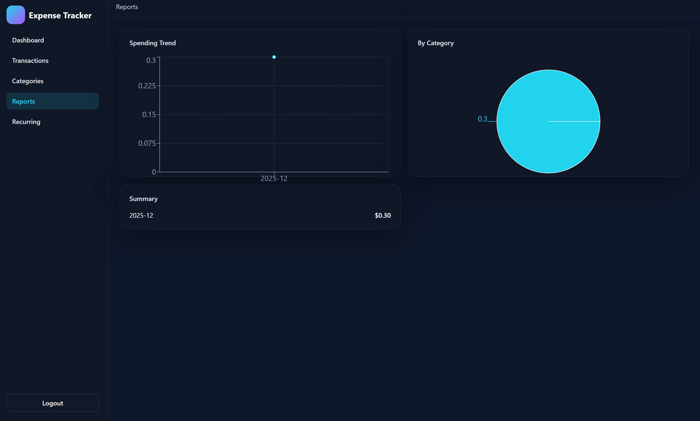
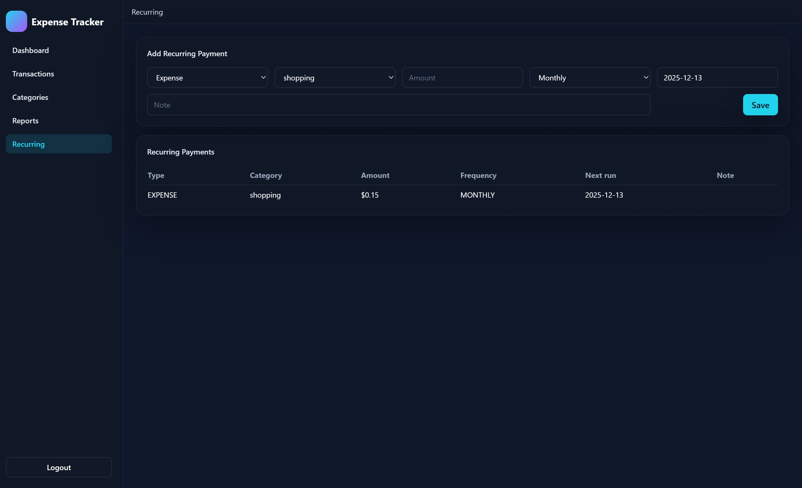

# Expense Tracker – Full-Stack Personal Finance Management

A full-stack personal finance management application built using **Java 17, Spring Boot, React, TypeScript, and MySQL/H2**. It enables users to manage income and expenses, organize transactions, monitor monthly budgets, and visualize financial activity through an interactive dashboard.

The application follows a RESTful architecture with JWT-based authentication, protected endpoints, server-side validation, and a responsive frontend.

## Features

### Authentication & Security
- User registration and login with JWT authentication
- Access token and refresh token workflow
- Spring Security integration
- Protected REST API endpoints
- User-specific data access
- Role-based authorization

### Transaction Management
- Create, update, and delete transactions
- Manage income and expense records
- Filter transactions by category, type, and month
- Paginated transaction listing
- Server-side request validation
- Transactions associated with authenticated users

### Category Management
- Create and manage custom categories
- Default categories for new users
- Category-based transaction filtering
- Category-wise spending analysis

### Interactive Dashboard
- Monthly income and expense summaries
- Automatic balance calculation
- Donut chart for category-wise spending
- Line chart showing the last six months of financial activity
- Dynamic dashboard powered by backend API data

### Recurring Payments
- Manage recurring expenses and subscriptions
- Track upcoming payment dates
- Calculate next payment dates
- Monthly recurring payment forecast

### Financial Reports
- Monthly financial summaries
- Category-wise expense breakdown
- Aggregated reporting queries
- SQL-based data analysis

## Technology Stack

| Layer | Technologies |
|---|---|
| Backend | Java 17, Spring Boot 3 |
| Security | Spring Security, JWT |
| Database | H2 Database |
| ORM | Spring Data JPA, Hibernate |
| API | REST APIs |
| Build Tool | Maven |
| Frontend | React, TypeScript, Vite |
| Styling | Tailwind CSS |
| State Management | Zustand |
| HTTP Client | Axios |
| Charts | Recharts |
| Version Control | Git, GitHub |

## Project Architecture

```text
expense-tracker/
│
├── src/
│   └── main/
│       ├── java/
│       │   └── .../
│       └── resources/
│
├── frontend/
│   ├── src/
│   ├── public/
│   ├── package.json
│   └── vite.config.ts
│
├── screenshots/
├── pom.xml
├── mvnw
├── mvnw.cmd
└── README.md
```

## Getting Started

### Prerequisites

Install the following before running the application:

- Java 17 or later
- Node.js and npm
- Git
- Maven (optional if using the included Maven Wrapper)

### 1. Clone the Repository

```bash
git clone https://github.com/PushpakG123/expense-tracker.git
cd expense-tracker
```

### 2. Start the Spring Boot Backend

**Windows PowerShell:**

```powershell
.\mvnw.cmd spring-boot:run
```

**macOS / Linux:**

```bash
./mvnw spring-boot:run
```

Backend URL:

```text
http://localhost:8080
```

### 3. Start the React Frontend

Open another terminal:

```bash
cd frontend
npm install
npm run dev
```

Frontend URL:

```text
http://localhost:5173
```

## API Overview

| Module | Method | Endpoint | Description |
|---|---|---|---|
| Authentication | POST | `/api/auth/register` | Register a user |
| Authentication | POST | `/api/auth/login` | Authenticate user |
| Authentication | POST | `/api/auth/refresh` | Refresh access token |
| Transactions | GET | `/api/transactions` | Retrieve transactions |
| Transactions | POST | `/api/transactions` | Create transaction |
| Transactions | DELETE | `/api/transactions/{id}` | Delete transaction |
| Categories | GET | `/api/categories` | Retrieve categories |
| Categories | POST | `/api/categories` | Create category |
| Categories | DELETE | `/api/categories/{id}` | Delete category |
| Reports | GET | `/api/reports/monthly?month=YYYY-MM` | Retrieve monthly report |

## Screenshots

### Login


### Dashboard


### Transactions


### Categories


### Reports


### Recurring Payments


## Testing

- Backend unit-level tests
- JWT authentication workflow testing
- H2 database for development and testing

## Future Enhancements

- Export financial reports in PDF and CSV formats
- Automated recurring payment processing
- Dark and light theme support
- Docker containerization
- PostgreSQL production configuration

## What This Project Demonstrates

- Building RESTful backend services using Java and Spring Boot
- Implementing authentication and authorization using Spring Security and JWT
- Designing relational data models with Spring Data JPA
- Integrating React and TypeScript with backend APIs
- Managing frontend application state using Zustand
- Implementing interactive financial dashboards and data visualizations
- Structuring and developing a full-stack application

## Developer

**Pushpak Ganganmale**

- GitHub: [PushpakG123](https://github.com/PushpakG123)
- LinkedIn: [Pushpak Ganganmale](https://linkedin.com/in/pushpak-ganganmale-784a0a32b/)

---

If you find this project useful, consider giving the repository a star.
